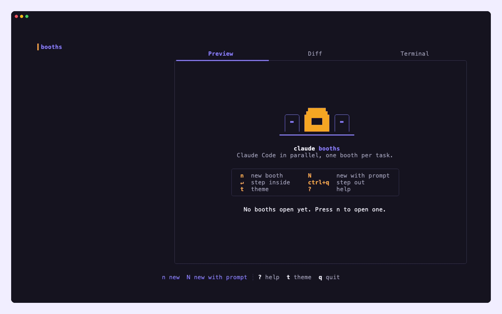

<p align="center">
  
</p>

<h1 align="center">Claude Booths</h1>

<p align="center">
  <b>Many chats. One terminal. Zero collisions.</b><br>
  Run AI coding chats side by side. Every booth gets its own git worktree and tmux session.
</p>

<p align="center">
  <a href="https://github.com/sudarshan032/claude-booths/actions/workflows/ci.yml"></a>
  <a href="https://github.com/sudarshan032/claude-booths/releases/latest"></a>
  <a href="LICENSE.md"></a>
  
</p>

<p align="center">
  <a href="https://sudarshan032.github.io/claude-booths/">Website</a> ·
  <a href="#install">Install</a> ·
  <a href="#usage">Usage</a> ·
  <a href="#keys">Keys</a> ·
  <a href="#configuration">Configuration</a> ·
  <a href="CONTRIBUTING.md">Contributing</a>
</p>

<p align="center">
  
</p>

## Why booths

You have five things to do. One chat at a time is slow; five chats in one folder overwrite each
other. Claude Booths gives every chat its own **booth**: a private git worktree on its own branch,
running in its own tmux session. You hop between them, watch live output, step in when one needs
you, and ship the branches that are ready.

- **Isolated**: each booth works on its own branch in its own worktree. No half-edited files from another task.
- **Live**: previews are streamed from tmux the moment output changes. Idle booths cost nothing (no polling).
- **Reviewable**: a diff tab per booth, then push the branch for a PR or check it out locally.
- **Any agent**: [Claude Code](https://github.com/anthropics/claude-code) by default; [Codex](https://github.com/openai/codex), [Gemini CLI](https://github.com/google-gemini/gemini-cli), [Aider](https://github.com/Aider-AI/aider), Amp or any CLI with `-p`.
- **Background mode**: `-y` auto-accepts prompts so booths can finish while you are elsewhere.
- **Eight themes**: press `t`.

## Install

```bash
curl -fsSL https://raw.githubusercontent.com/sudarshan032/claude-booths/main/install.sh | bash
```

This puts `claude-booths` in `~/.local/bin`. Prefer a shorter name?

```bash
curl -fsSL https://raw.githubusercontent.com/sudarshan032/claude-booths/main/install.sh | bash -s -- --name booths
```

From source (Go version in `go.mod`): `go build -o ~/.local/bin/claude-booths .`

**Needs** [tmux](https://github.com/tmux/tmux/wiki/Installing) and git, plus [gh](https://cli.github.com/) to push branches.

## Usage

Run it inside any git repository:

```bash
cd your-project
claude-booths
```

Press `N`, name the booth, type what you want done, and press Enter. Open as many as you like.

```text
Usage:
  claude-booths [flags]
  claude-booths [command]

Commands:
  debug       Print debug information like config paths
  reset       Reset all stored booths
  themes      List color themes, or set one (also: press t in the app)
  version     Print the version number

Flags:
  -p, --program string   Program to run in new booths (e.g. 'aider --model ollama_chat/gemma3:1b')
  -y, --autoyes          [experimental] All booths automatically accept prompts
```

Other agents:

```bash
claude-booths -p codex          # needs OPENAI_API_KEY
claude-booths -p gemini
claude-booths -p "aider --model ollama_chat/gemma3:1b"
```

To make one the default, set `default_program` in the config (path: `claude-booths debug`).

## Keys

| Key | Action |
|---|---|
| `n` / `N` | New booth / new booth with a prompt |
| `↑` `↓` (`k` `j`) | Move between booths |
| `↵` / `o` | Step inside the selected booth (full screen) |
| `Ctrl+Q` | Step back out |
| `tab` | Switch Preview · Diff · Terminal |
| `shift+↑` `shift+↓` / wheel | Scroll the preview or diff (`Esc` to return) |
| `p` | Commit and push the booth's branch (for a PR) |
| `c` | Checkout: commit changes and pause the booth |
| `r` | Resume a paused booth |
| `D` | Delete the booth (worktree and branch) |
| `K` / `J` | Reorder booths |
| `t` | Next theme |
| `?` | Help |
| `q` | Quit (booths keep running in tmux) |

## Configuration

Stored in `~/.claude-booths/config.json` (`claude-booths debug` prints the path).

| Key | Default | What |
|---|---|---|
| `default_program` | `claude` | Command (or profile name) new booths run |
| `branch_prefix` | `<your-user>/` | Prefix for new booth branches, e.g. `booths/` |
| `theme` | `claude-booths` | Color theme |
| `auto_yes` | `false` | Same as `-y` |
| `profiles` | none | Named programs, picked with `←` `→` when opening a booth |

```json
{
  "default_program": "claude",
  "branch_prefix": "booths/",
  "theme": "claude-booths",
  "profiles": [
    { "name": "claude", "program": "claude" },
    { "name": "codex", "program": "codex" },
    { "name": "aider", "program": "aider --model ollama_chat/gemma3:1b" }
  ]
}
```

### Themes

```bash
claude-booths themes           # list with swatches, * marks the active one
claude-booths themes nord      # set one
```

`claude-booths` (default) · `dracula` · `gruvbox` · `monokai` · `nord` · `ocean-green` · `solarized` · `vscode`.
Themes color the UI and each booth's tmux status bar; the background stays your terminal's.

## How it works

1. **git worktrees** give every booth its own checkout and branch, cut from your current `HEAD`.
2. **tmux** runs every agent in a background session; the app reads a streaming tmux client per booth, so previews update the moment output changes.
3. **A Bubble Tea TUI** ties it together: list, live preview, diff and a plain terminal per booth.

## FAQ

**`failed to start new session: timed out waiting for tmux session`**
Update the agent CLI (for example `claude`) to its latest version.

**Uncommitted changes in my main folder aren't in the booth.**
Booths start from your last commit. Commit first if a booth needs those changes.

**Where are the worktrees?** `~/.claude-booths/worktrees/`. Deleting a booth (`D`) removes its worktree and branch.

## Contributing

Bug reports and PRs are welcome. Read [CONTRIBUTING.md](CONTRIBUTING.md) for the branch and commit
conventions, tests and release steps. Brand assets and the design system live in [BRAND.md](BRAND.md).

## License

[AGPL-3.0](LICENSE.md). Claude Booths is a modified version of
[claude-squad](https://github.com/smtg-ai/claude-squad) by smtg-ai, also AGPL-3.0; the original
copyright and license are retained.

"Claude" is a trademark of Anthropic. This project is not affiliated with or endorsed by Anthropic.
